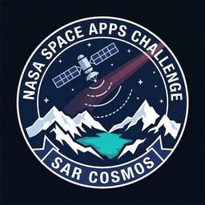
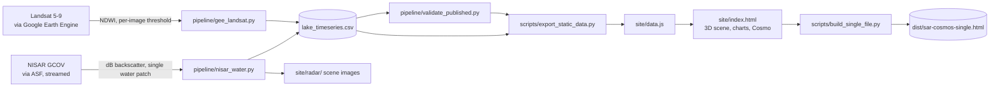
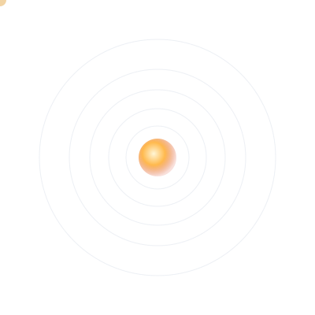

<p align="center">
  
</p>

<p align="center">
  
</p>

<h1 align="center">SAR Cosmos</h1>
<p align="center"><em>Watching Nepal's glacial lakes from orbit, through the monsoon.</em></p>

<p align="center">
  <a href="https://shivamdual.github.io/sar-cosmos/"><strong>🌐 Live Interactive 3D Platform: shivamdual.github.io/sar-cosmos</strong></a>
</p>

<p align="center">
  
  
  
  
  
</p>

---

## Why this exists

Nepal has **21 glacial lakes** officially classed as critically dangerous. A **2011 ICIMOD study** found proper mitigation at only two of them. Between **1977 and 2020**, Nepal recorded **26 glacial lake outburst floods (GLOFs)**, 14 of them starting inside the country.

Optical satellites cannot see these lakes through the **monsoon**, which covers the Himalaya in cloud from June to September, the same months the glaciers melt fastest. **NISAR**, the NASA-ISRO radar satellite, sends its own microwaves through cloud, day and night. SAR Cosmos uses it to keep watching the lakes when nothing else can.

## What it does

| | |
|---|---|
| **A 3D Himalaya you can fly through.** | Scroll through a generated range with six lakes, orbiting NISAR, and a monsoon that rolls in and clears. |
| **Optical and radar, side by side.** | Switch between a sunlit view and a radar view. A scanning wipe shows the same ground as NISAR sees it. |
| **Lake history, in one panel.** | Scrub 2000 to 2026, see area change, the growth tier, and error bars on every published measurement. |
| **Radar scenes with the water outlined.** | Each NISAR scene is shown with the single water patch the method measured, and excluded scenes are labelled. |
| **An observation calendar.** | See, month by month, when anyone actually measured these lakes. The monsoon gap is a checkable fact. |
| **Cosmo, the assistant.** | Ask anything. Cosmo answers about the project and the science, writes essays and summaries, and opens printable documents. Inside a supported AI viewer it uses that viewer's AI model. |
| **Printable fact sheets.** | Every lake has a fact sheet with its measurements, sources and limits, ready to print or save as PDF. |
| **One file, no server.** | `dist/sar-cosmos-single.html` opens offline on a phone or a PC. |

## Honest status

SAR Cosmos separates what is measured from what is shown, and the site says which is which.

| Part | Status |
|---|---|
| Lake areas on the site | **Published measurements, 2000 to 2015** (Rounce et al. 2016, about 10% error) |
| Landsat optical pipeline | Written and tested on synthetic images. **Awaiting its first live run.** |
| NISAR radar pipeline | Written and tested on synthetic NISAR-style files. **Awaiting its first live run.** 28 to 36 calibrated scenes exist over each lake. |
| Risk tiers | Our own plain rule on five-year growth. **Not** a flood probability. |
| Flood forecasting | **Not done, and not claimed.** Timing and depth need flood modelling run with the responsible authorities. |

The website switches to pipeline results automatically once they exist. Until then, it never shows synthetic numbers. Tests enforce this.

## Quick start

```bash
# see the site (no installs, no server)
open dist/sar-cosmos-single.html          # or double-click it in your file browser

# rebuild everything after a change
python scripts/export_static_data.py
python scripts/build_single_file.py

# run the tests
python -m pytest tests -q
node tests/js/brain.test.js
node tests/js/brain-write.test.js
```

Running the real satellite pipelines on a laptop is covered in [`RUN_ON_LAPTOP.md`](RUN_ON_LAPTOP.md).

## How it works



## Method, in one paragraph

**Optical:** NDWI = (green − NIR) ÷ (green + NIR) on Landsat, threshold chosen per image with Otsu's method, keeping only the water patch that contains the lake. **Radar:** NISAR L-band backscatter in dB, 3×3 median despeckle, Otsu threshold, the same single-patch rule. Radar shadow is dark too, so a dark patch away from the lake is logged and never counted. **Validation:** optical areas are compared with published areas for the same lakes and dates, and radar areas with optical areas from within 14 days. **Risk tier:** under 10% five-year growth is Low, under 25% Moderate, under 40% High, otherwise Critical.

## The six lakes

Imja Tsho · Tsho Rolpa · Thulagi (Dona) · Lower Barun · Lumding Tsho · Hongu (Chamlang South)

Coordinates for Lumding and Hongu are still being verified against ICIMOD lake polygons (`--verify-positions`).

## Repository map

```
sar-cosmos/
├── site/            the website: 3D scene, charts, Cosmo (plain HTML, CSS, JavaScript)
├── pipeline/        the satellite pipelines (Landsat, NISAR) and validation
├── scripts/         data export, knowledge build, single-file build, GitHub publish check
├── worker/          optional AI proxy for Cosmo (Cloudflare Worker, keys stay on the server)
├── data/            lake metadata, published reference areas, processed results
├── docs/            design guide, artwork, submission and video notes
├── tests/           Python and JavaScript test suites
└── dist/            the single-file build you can open anywhere
```

## Data and credits

- **Landsat 5, 7, 8 and 9** Collection 2 surface reflectance, via Google Earth Engine.
- **NISAR** (NASA and ISRO) L-band GCOV products, via the Alaska Satellite Facility DAAC. Calibrated public data from 17 June 2026.
- **Published lake areas:** Rounce, D. R. et al. (2016), *Hydrology and Earth System Sciences* 20, 3455–3475.
- **Dangerous-lake and mitigation counts:** ICIMOD (2011, cited in its 2019 Tsho Rolpa reassessment); ICIMOD and UNDP Nepal (2020).
- **Watanabe, T. et al. (2009)**, *Norsk Geografisk Tidsskrift* 63(4), for Imja Tsho.

## Team

**Shivam Prasad Raut** (Lead), **Aarambha Ghimire**, and **Saurav Bhattrai**. Khwopa Engineering College, Bhaktapur Local Event, NASA Space Apps Challenge 2026.

## Use of AI

This project was built with substantial AI coding assistance for code, interface, tests and documentation. The team directed the approach, chose the data sources, checked every figure against its source, and removed any number it could not verify. Everything shown on the website traces to a cited source or to this project's own pipelines.

## Limits, stated plainly

- The 3D terrain is generated for illustration. Lake order is real; spacing is not.
- Published areas carry about 10% error of their own.
- NISAR's calibrated public record starts in June 2026, so radar covers one season so far.
- SAR Cosmos measures lake size and growth. It does not forecast outbursts, flood timing, flood depth or evacuation needs.

<p align="center"></p>

<p align="center">
  
  &nbsp;&nbsp;
  
</p>

<p align="center"><sub>Built for the mountains, the monsoon and the people downstream.</sub></p>
